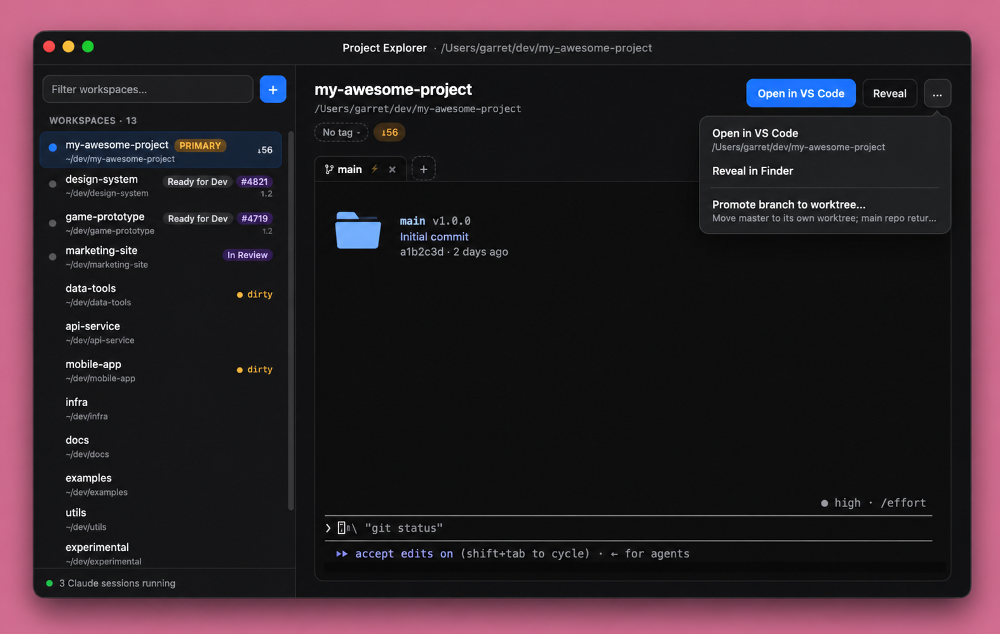

# Trek Dev

An Electron + React + TypeScript app for running Claude Code, or Codex, Gemini, Grok and
local models, across multiple git worktrees of a repository, side by side.



## Concepts

Every project lives on a **server**: the [Local server](#local-server) Trek runs on this
machine, or a [trek-server](server/README.md) on another one. The server keeps the
project, its worktrees and its agent sessions; a Trek window shows one project and
sends every action to its server, and every other window on that project sees it live.

- **Start screen**: an empty window offers **New Project…** (it asks which server:
  Local, first, picks a folder on this machine; another server lists its registered
  repositories), **Open on server…** (the servers, Local first, and their projects) and
  **Import .trekproj…** (see [Importing a .trekproj](#importing-a-trekproj)), above the
  recent projects. File → New Project… (⌘N) and File → Open on Server… (⌘O) open those
  views, in the focused window when it is empty, or in a new one; while a project is
  being created, the start screen keeps its view.
- **Repositories**: a project lists one or more; each is a collapsible sidebar section,
  and a collapsed section still shows its session status. The section's **⋯** menu
  removes a repository from the project without touching the disk; it can't be removed
  while it has live sessions. Tags, notes, tickets, PR links and env vars are kept per
  repository, so a branch name shared by two repositories has independent data.
- **Worktree sidebar**: lists every git worktree of each repository, with the session
  status dot, branch, workflow tag, ticket/PR chips and git ahead/behind/dirty state,
  as the server's git poller reports them. The `+` on a repository's section creates a
  worktree (`git worktree add`, next to the repository as `<repo>-<branch>`) or checks
  one out from a pull request. The main checkout is tagged **PRIMARY**.
- **Workflow tags**: each branch can carry a tag (In Progress, In Review, Changes
  Needed, Waiting for SQL, In Testing, Ready for Dev, Ready to Deploy, Remove) — click
  the tag chip in the detail pane to change it, and filter the sidebar by tag with the
  "Tag:" dropdown under the worktree list. New worktrees start as **In Progress**. Tags,
  like notes, tickets and PR links, are keyed to the branch, so they survive the
  worktree being deleted and re-created.
- **Detail pane**: the selected worktree's branch, path and linked ticket/PR, with quick
  actions (Open in VS Code and Reveal in Finder, in a Local window) and an overflow menu
  (link ticket/PR, delete worktree). A ticket is a Linear issue (`TOW-123`, or paste its
  `linear.app/<workspace>/issue/…` URL) or a legacy Azure DevOps work item id; when the
  branch name contains a Linear id the ticket dialog pre-fills it. Add a Linear API key
  in ⚙ Settings to show each issue's status and title on its chip; the key is the
  window's server's (stored there, owner-only, never sent back to any client), shared by
  every project on that server. The **All Notes** panel
  collects every branch note in one place — including branches whose worktree is gone —
  with a per-note delete.
- **Sessions** (per worktree): each session tab is an agent the server runs in the
  worktree, in a real PTY. ⌘T (or the `+` next to the tabs) opens a new one, click the
  active tab's title to rename it, and an exited session shows **Restart** (which
  resumes the same conversation).
- **Loading / unloading worktrees**: each session costs a process on the server, so
  worktrees with saved sessions start unloaded. A hollow dot and a **▸N** button in the
  sidebar row (and **Load sessions** in the detail pane) load them; **⏏** unloads them
  again, keeping the sessions to resume.
- **Agents**: each session runs one agent CLI: **Claude** (`claude`), **Codex**
  (`codex`), **Gemini** (`gemini`), **Grok** (`grok`) or **Local** (Claude Code pointed at
  Ollama or LM Studio). The server's config (`llm`) sets each agent's command and the
  default; a project can override the default and pick the Global panel's agent.
  Session types can name their own agent, and `▾ → Choose…` next to `+` picks one for a
  single session. A session always resumes with the agent it started with.
- **Global panel** (⌘J, or click the status bar at the bottom of the window): a
  project-wide agent session in a collapsible panel, running in the first repository's
  root, with the trek-dev MCP tools to drive the worktree sessions.
- **MCP server**: each trek-server serves the `trek-dev` MCP tools to its sessions,
  scoped to the session's own project (list worktrees, start, load and unload sessions,
  send prompts and keystrokes, read terminal output, wait for sessions, edit a queue,
  set a branch's tag, note or ticket, ask the user to decide). See
  [PROTOCOL.md](PROTOCOL.md#mcp-trek-dev-on-the-server).
- **Multiple windows**: one window per project. Opening a project another window holds
  focuses that window; `File → New Window` (⌘⇧N) opens an empty one. Closing a window
  asks nothing: its sessions keep running on the server. On launch, the windows open at
  the last quit come back (`open-windows.json` in the user-data directory).
- **Recent projects**: the start screen lists the last 8 projects you opened. A
  `.trekproj` there is one not imported yet (marked **import**): opening it imports it.
  A server project stays until you remove it with its **×**.

## Project bot sandbox

**The project bot is dormant until phase 5**, when it moves onto trek-server: it ran in
project file windows, which are gone, so no window offers it now. Its code stays in the
tree (`src/host/bot/`, compiled and tested; its Electron wiring, `src/main/bot.ts`,
`src/renderer/src/bot.ts` and `BotPanel.tsx`, is excluded from the build), and what
follows describes it as it was, and as phase 5 brings it back.

Every project bot turn runs in an OS sandbox (`sandbox-exec` on macOS, `bwrap` on
Linux) that hides Trek's user-data directory from the bot's own processes. Each bot
start first proves the sandbox works by trying to read a canary file. If the read
succeeds, or no sandbox is available, the bot won't run. A bot folder or repository
inside the user-data directory is refused too.

Trek's MCP server enforces the bot's policy on every tool call. These eight tools
run something outside the sandbox, so they always ask for your approval, whatever
`POLICY.json` says: `start_session`, `send_prompt`, `send_keys`, `start_stack`,
`create_worktree`, `load_worktree`, `save_session_type`, `delete_session_type`.

**What it doesn't do yet:** it does not stop a determined, prompt-injected bot from
getting code run outside the sandbox. The main ways:

- **Files that run later.** The bot can write files outside the user-data directory
  that unsandboxed programs run later: git config, fsmonitor and hooks (Trek's own
  `git status` runs them), shell rc files, `~/.claude` settings hooks, the project
  file, `stack.sh`, LaunchAgents.
- **Local services.** It can drive unsandboxed local services (Docker, tmux, D-Bus or
  `systemd-run` on Linux, local dev servers), and Apple Events (`osascript`), gated
  only by macOS's Automation consent. The network isn't restricted.
- **Delegation.** `enqueue_prompt` is free and reaches unsandboxed sessions; approved
  `start_session`, `send_prompt` and `send_keys` run unsandboxed sessions.
- **macOS process info.** The bot can read the environment and arguments of any of
  your non-system processes, including `environments.json` values passed to
  `docker compose`. Trek keeps its own tokens out.

Smaller gaps: disk mounts over a parent of the user-data directory (macOS), the bot's
own per-turn token in its environment, a local trek-server's data folder, earlier
copies (hard links, backups, snapshots), Codex older than 0.148 (no Trek tools),
the probe running only at start, and `bwrap` found through PATH. Windows is
unsupported: the bot doesn't run there. The full list is in
`docs/superpowers/specs/2026-11-02-project-bot-core-design.md`. A write allow-list,
which closes the "files that run later" gap, is the planned follow-up.

## Servers and server projects

Every project lives on a [trek-server](server/README.md) (the Local server included), which
keeps their worktrees and sessions running on that machine. A server window is a
working window: its terminals, sessions and edits all go to the server, and every
other window on that project sees them live.

- **Server list**: **Open on server…** on the start screen (File → Open on Server…,
  ⌘O) opens the app-wide
  list of servers. **Add server** takes a name, a `ws://` or `wss://` URL and a token;
  each server then has **Set token**, **Test**, **Edit** and **Remove**, and a dot
  for its connection status. Plain `ws://` to anything but this machine is allowed
  (Tailscale, LAN) but shows an "Unencrypted" warning, the app-side half of the
  server's rule never to expose its plain `ws://` listener beyond loopback (see
  [Security notes](server/README.md#security-notes)). Create tokens on the server
  with `trek-server token add <device>` (see [the server README](server/README.md#projects)).
- **Tokens** are encrypted with the OS keychain (Electron safeStorage) in
  `app-server-tokens.json` in the user-data directory, owner-only. When no OS
  keyring is available (for example on Linux without one) safeStorage can't
  encrypt, and tokens are stored only base64-encoded with a `plain:` prefix, so the
  file's owner-only permissions are then the only protection. They never reach
  the window: main opens the WebSocket, relays it, and puts the token into the
  `hello` itself. Changing a server's URL to another origin (scheme, host or port)
  clears its token, so you enter it again.
- **Projects**: pick a server to list its projects and **Open** one, or
  **New Project…** to create one from a name and the server's registered repos.
  **Add repo by path…** registers another repo there; if the server refuses the
  path (`PATH_DENIED`) or it isn't a git repo (`NOT_A_REPO`), the hint is to run
  `trek-server add <path>` on the server.
- **Server windows**: one per server project, focused if it's already open. It
  lists the repositories, their worktrees (branch, missing, dirty/ahead/behind,
  loaded) and each worktree's sessions, plus Global sessions, updating live. If the
  connection drops, a banner says so and the last tree stays. A project deleted on
  the server, or one it doesn't know when the window opens, shows "Project not
  found" with **Pick another project**; a server
  you removed from the list shows "Server removed". A window stuck on a rejected
  token or an incompatible server tries again when you focus it, so a token set in
  another window takes. Closing the window asks
  nothing, since the sessions keep running on the server. Server windows appear in
  recents and come back on launch.
- **Working in a server window**: start, rename, close and restart sessions in
  the server's terminals; queue prompts; answer and dismiss decisions; create,
  delete, load and unload worktrees; pull, push and view changes; set tags,
  notes, tickets and pull request links; and edit the project's Settings. Each
  edit is saved on the server, a text field on blur. If another client changed a
  setting first, you pick **Reload** or **Keep Mine**; a Docker favourite or an
  environment setting is re-applied over the other client's change without
  asking. Attention badges and the notifications menu cover server sessions.
  Linear ticket chips work in every server window, with that server's API key.
- **Docker, environments and dev stacks, on the server's machine**: every server
  window has the Docker tab (the server's containers, and docker compose in a
  repository's main checkout), the per-worktree Colima environments (and their
  variables) and the dev stacks (`docker/stack/stack.sh`), all run by the server
  on its own machine, with its own docker and colima. A server without them
  installed says so in the panel. Deleting a worktree also destroys its dev stack
  (if ticked) and its VM, after a fresh check for uncommitted changes on the
  server; if the server does not answer that check in time, nothing is deleted.
  A server older than this Trek (without the `docker`, `env` and `stacks`
  capabilities) shows no Docker, Env or Stack tab, and Trek does not fall back
  to running them on this machine.
- **Linear, voice summaries and skills, on the server**: each server keeps its own
  Linear and ElevenLabs keys (⚙ Settings, set from any window on it; neither is ever
  sent back to a client), its voice and model, and whether its sessions are told to
  speak a summary when they finish ("Summarize automatically"). A session's
  `speak_summary` is synthesized on the server and played in every Trek window that
  has its project open, unless that app is set to Busy (the sidebar's Active/Busy
  toggle, a setting of this app). The ⚡ skill menu lists the worktree's
  `.claude/skills` and `.claude/commands`, and the server user's `~/.claude` ones, read
  on the server. Its agents also get the `get_stack`, `start_stack`, `stop_stack` and
  `read_stack_log` MCP tools. A server older than this Trek (without the `linear`,
  `voice` and `skills` capabilities) shows none of these.
- **Pull request watch, on the server**: with a pull request linked to a branch, the
  worktree's … menu has **Watch pull request** (agents can call `watch_pull_request`).
  The server asks `gh` on its own machine about it every few minutes; when its checks
  fail or pass, new reviews or comments arrive, it gets a merge conflict, or it is
  merged or closed, a prompt saying so (and which `gh` command shows it) is queued on
  the worktree's newest session, and the worktree is flagged in the sidebar and the
  notifications menu until you dismiss it. Nothing is started for a worktree with no
  session. After merged or closed the watch turns itself off. A pull request the
  server cannot read three polls in a row flags the worktree too. It needs `gh`
  installed and signed in (`gh auth login`) as the server's user; without that the
  menu item is not shown (a sign-in or sign-out on the server shows within about 10
  minutes).
- **Changes tab review**: the Changes tab's picker compares the branch against its
  base (the default), the uncommitted work only, or one of the newest 100 commits.
  Hover a line and click **+** to comment on it; the draft review is kept on the
  server, so every window on it (and a restart) sees the same comments, and it is
  sent with **Send to session**, which lists the worktree's open sessions newest
  first and queues every comment, with its file, line and the line's text, as one
  prompt (sent from the queue like any other). A comment whose line has changed
  since shows as outdated at the top of its file, and is still sent with the line
  as it read. Comments on another source are listed in the review bar. The tab
  stays read-only: nothing stages or reverts. Agents can read the draft with the
  `get_review_comments` MCP tool (read-only; each comment says whether it is
  outdated). A server older than this Trek (without the `review` capability) shows
  only the branch against its base.
- **Web client**: a server started with `trek-server start --web` serves the project
  window to a browser at its own address, for any device (through the server's TLS
  proxy). Sign in by pasting a server token once (the browser keeps an HttpOnly
  cookie, never the token), pick a project, and use it as in the app: sessions,
  terminals, the queue, the Changes tab review, the PR watch, stacks and settings.
  What needs the browser's own machine (Open in VS Code, Reveal in Finder, folder
  pickers, the Local server) is not offered. Serve it on a host name no other
  service or dev stack is reached on: cookies are not port-scoped, so any other web
  server on that name (on loopback, any local web server the browser visits) sees
  the session cookie. See [trek-server's README](server/README.md#web-client).
- **Move a worktree to another server**: **Move to another server…** in a worktree's
  menu (in a window whose server has another server saved beside it in the app) picks
  one of the app's other servers and a project there with a clone of the same
  repository (the same origin). The branch is pushed to origin and checked out there,
  the uncommitted work goes along as a patch (all of it unstaged), Claude sessions'
  histories are copied so they resume there, and the note, tags, ticket, pull request,
  its watch and the branch's Docker .env come too. Other agents' sessions, queued prompts and the review draft
  do not. Its Docker VM and dev stack, if it has them, are torn down on the old server
  once the new worktree is in place (a ticked-by-default checkbox; unticked while they
  run, Move is disabled until they are stopped). The dialog warns about what is deleted
  with the old worktree and does not travel: its ignored files and the changes to files
  flagged assume-unchanged or skip-worktree. The old worktree is removed last, and only
  if nothing changed in it while it was copied; if it did, the new copy is undone on the
  other server (unless its VM and stack were already torn down: then both are kept to
  compare). Cancel works until the other server starts creating it; closing the window
  or quitting while a move runs asks first. The web client never offers it (it has one
  server).
- **This machine's features, in Local windows only**: a window on the [Local
  server](#local-server) also has Open in VS Code and Reveal in Finder, since its
  paths are this machine's. A window on a remote server shows neither.
- **Promote to primary**: **Promote to primary…** in a worktree's menu checks its
  branch out in the repository's main checkout (which must have no uncommitted
  changes), with the worktree's uncommitted work (unstaged), then deletes the
  worktree. Its Claude and local-model sessions move to the main checkout with their
  histories and resume there; other agents' sessions are closed; the main checkout's
  own sessions keep running on the new branch. The note, tags, ticket, pull request
  and its watch are the branch's, so they stay with it; the review draft moves if the
  main checkout has none. Its dev stack and VM go as with Delete (the same checkbox).
  **Promote branch to worktree…** on the main checkout does the reverse: its branch
  and uncommitted work go to a new worktree at `<repo>-<branch>`, the sessions that
  can follow go with them, and the main checkout returns to the default branch. Each
  is one request on the server: any failure puts both checkouts back as they were.
  An agent can ask for a promote with the `promote_to_primary` MCP tool; every window
  with the project open (the web client's too) shows the confirmation, and the tool
  waits for the answer.
- **Not yet**: the project bot (after the native client).

## Phone companion

The Trek phone app (`apps/mobile`, Expo, iOS and Android; phase 6a) is for watching and
steering agents away from the desk. Its home tab lists what needs you on every paired
server, newest first: decisions waiting (answered right there), sessions that finished
or stopped, pull request notices. From there: a server's projects, a worktree (load or
unload it, start a session with an agent or session type, close or restart one, its
read-only Changes), and a session's terminal with a key bar (Enter, Esc, Tab, ^C,
arrows, y, n) and a prompt box that sends now or queues. While a project is open on
the phone, an agent's `promote_to_primary` can be confirmed there, unless the
worktree's dev stack or Docker VM is running (then only the desktop can, since it
tears them down first).

- **Pairing**: in **Open on server…**, a connected remote server has **Pair a phone…**.
  It shows a QR and a one-time code (5 minutes, used once), never a token. Scan it in
  the app's **Add server** (or type the server's address and the code): the phone
  gets its own named token, `phone-<its name>`, kept in the phone's secure storage.
  Revoke it with `trek-server token revoke phone-<name>` to unpair. Pair a phone… is
  not offered for the Local server or a `localhost` / `127.0.0.1` address: a phone
  can't reach those. Expose the server first (server/README.md, "Expose it with
  Caddy").
- **Addresses**: `wss://` always; plain `ws://` only to a private network address
  (LAN, Tailscale, `.local`), with a warning.
- **Not yet**: notifications while the app is closed (6b: a push relay), and
  creating, moving or promoting worktrees from the phone.

See `apps/mobile/README.md` to build and run it.

## Importing a .trekproj

A `.trekproj` is the project file older Trek builds kept projects in. Trek no longer
opens one as a project: opening one (a recent project on the start screen, or the file
from Finder) imports it: the part on this machine becomes a project on the Local
server, and each part on a remote server becomes a project there, and their
windows open. **File → Import .trekproj…** does the same, and can import a file
again. On the first launch with Local, Trek offers once to import the files in
your recent projects and the windows open at the last quit.

**Opening a `.trekproj` imports it without asking**, from Finder or a recent
project: its part on this machine goes to Local, and
each remote part goes to a server you have already saved at that address. Only
a server you have not saved is asked about. The project's settings come with
it, so its agent command (`claudeCommand`, `llmDefault`) and the rest then apply
on those servers too: open a `.trekproj` only if you trust where it came from.

- The `.trekproj` file is never changed. `migrated.json` in Trek's app data
  remembers what each file became, so opening it again opens those projects.
- A remote part goes to the server in your list at the same address (scheme,
  host, port and path); if none is, Trek offers to add it, with the token saved
  for that address, if any. A token is only ever carried to its own origin
  (scheme, host and port).
- Settings, tags, notes, tickets, pull requests, environment variables, linked
  folders, environments, queues, session types, saved sessions and the worktree
  order come along, the order following a worktree whose path the server resolves
  differently (a symlinked path, such as macOS's `/var`, which is `/private/var`).
  Open tabs, drafts, running terminals (sessions come back idle
  and resume when loaded) and the project bot's settings do not: the whole `bot`
  setting is dropped, `enabled` and its folder included, so a project's bot is set
  up again on its server.
- Paths become their realpaths on the server. Claude's saved histories are copied
  (never moved) to them on Local, and a repository's VMs keep their names.
- When none of a file could be imported, the result says what was left and why,
  with only **OK**, and nothing opens; opening the file again tries again. With the Local server off (`TREK_NO_LOCAL_SERVER=1`)
  its part on this machine is left, with that reason.
- A window left on a file that was not imported does not come back at the next
  launch; the file stays in your recent projects, marked **import**, and opening
  it from there imports it. A window on a file that was imported comes back on
  its project on Local.
- Each import asks about adding a server once, however many of the file's
  server ids share its address, and imports at most 20 remote parts of a file;
  the rest are listed as not imported, and once any part of the file has landed,
  opening it again offers to import them.

## Local server

Trek runs a trek-server of its own on this machine, the **Local** server. It is
listed first under **Open on server…** and **New Project…**, and Trek starts it, finds it and
connects to it itself, so it needs no URL or token. New Project… (on the start
screen, or File → New Project…, ⌘N) on Local picks a folder on this machine.

- **It keeps running after you quit Trek**, so its sessions do too, and the next
  launch reconnects to it. To stop it whenever Trek quits, turn on **Stop local
  server on quit** in ⚙ Settings.
- **File → Local Server** shows its state, with **Start Local Server** (or
  **Restart Local Server** while it runs) and **Stop Local Server**. The server
  list and a Local window offer Start and Restart too. Restart asks first: it
  closes every terminal on Local, and agent sessions resume when you open their
  worktrees again.
- **Reset Local Server** is offered when a start fails because another process
  holds the server's lock (`local.lock`) but no Local server answers. It removes
  that lock only when no process that could be the server holds it (a dead pid, or
  a live one that is not a trek-server and has held it longer than a start takes),
  and then starts the server. Otherwise it says so and leaves the lock alone.
- **Its log** is `~/.config/trek-server/local/server.log`, or
  `~/.config/trek-server/local-dev/server.log` for a dev build. A failed start's
  error shows the log's last lines.
- **After an update**, the server still running may be another version than the
  one this Trek bundles. Trek asks once whether to restart it with its own
  version; Keep Running carries on with it, and the list says it is not this
  Trek's version.
- **Your environments and dev stacks carry over.** Before this version, Trek ran
  Docker, the Colima environments and the dev stacks itself, and kept their
  registry in its app data (`environments.json`, and each stack's log and pid in
  `stacks/`). The Local server runs them now: on its first start that has no
  registry of its own, it copies Trek's (Trek's registry and pids stay where they
  were; a stack's log is shared, and both only append to it), so your VMs,
  containers and volumes, and a stack that is still running, are its own, under
  the same names. A stopped stack's pid is not copied. A branch variable the
  server refuses (`PATH`, `HOME`, `DOCKER_*` and the like) or a compose file
  outside the worktree is left out of the copied registry, but not out of the
  branch's variables or the repository's Compose file setting, which Start sends:
  Start is then refused (`envVars: PATH cannot be set …`) until you remove the
  variable in the Env tab or pick a compose file inside the worktree. If Trek's registry
  cannot be read then, nothing is copied and the next start tries again. Until you restart an older Local server (Keep
  Running), a Local window has no Docker, Env or Stack tab. An older Trek still
  running on the same app data after the take-over, or the other Local profile
  (a dev build's), starts stacks this one cannot see: each takes its own copy.
  Each Local profile reads the other's registry too, so a VM the other one
  created is not offered for deletion in Settings; a VM another trek-server on
  this machine created is (Settings says it may be another Trek's, and Delete
  removes its containers and volumes).
- **Your Linear and ElevenLabs keys carry over.** Before this version Trek kept one
  Linear key and one ElevenLabs key (and the voice, the model and "Summarize
  automatically") for every window. Each server has its own now: once the Local
  server runs, Trek hands it this app's keys, once per Local profile, and only
  where the server has no key of its own (one set there wins). The voice, the model
  and "Summarize automatically" go with the ElevenLabs key only when that key is
  stored on the server: a server that already had its own key keeps its own voice
  settings too. The keys are stored as they are, without asking Linear or
  ElevenLabs, so it works offline; a hand-over that fails (an older Local server, a
  key this app cannot decrypt now) is tried again at its next start. Trek's own
  files are left as they were. A remote server needs its keys set once from any
  window on it; a key set, cleared or changed in one window shows in every window
  on that server. Active/Busy stays this app's setting.
- **A server older than this version has no Linear or voice summaries.** Linear
  issues and spoken summaries now come from the window's server, so a window on an
  older trek-server (remote, or a Local server you kept running across the upgrade)
  shows "This server is older than Trek 5b" in Settings in their place, and its
  ticket chips show the bare id, until that server is updated (restart the Local
  server, or upgrade the remote one).

## Attention indicators

Each session tab shows a status badge, and each sidebar row a status dot:

| Badge | Meaning |
| --- | --- |
| spinner | Claude is producing output (working) |
| orange `?` (pulsing tab) | Claude rang the terminal bell — it's waiting on you |
| green `✓` | Output went quiet after activity — Claude is likely done |
| hollow `✓` | Marked fully complete — status tracking paused |
| gray `✕` | The process exited |

Click a green `✓` to mark that terminal **fully complete**: the badge hollows
out and the terminal stops producing status changes and notifications entirely.
Click the hollow `✓` to resume tracking — or just type in the terminal, which
re-engages it automatically.

Focusing/clicking a terminal clears its badge. A sidebar row's dot shows the
highest-priority status of that worktree's sessions (pulsing green = working,
orange = needs you, solid green = done, gray = idle, hollow ring = unloaded
with saved sessions).

The server works the status out from each session's output. You also get native
macOS notifications, raised once by the app for every server: when a session needs
you or is done while its project's window isn't focused. Clicking one focuses (or
opens) the project's window and jumps to that session; the bell in the sidebar lists
them all.

> **Tip:** for the most reliable "Claude needs you" signal, enable bell
> notifications in Claude Code: `claude config set --global preferredNotifChannel terminal_bell`.
> The idle detection works either way.

## Development

```bash
npm install       # also installs server/ (postinstall: npm --prefix server install)
npm run rebuild   # rebuild node-pty against Electron's Node headers
npm run dev       # launch in dev mode with HMR
npm run build     # production build into out/
npm run typecheck
```

`npm run dev` and `npm run build` bundle the server too (`npm run build:server`
writes `out/server`), so they need `server/node_modules`; the root `postinstall`
installs it. The app runs that bundle as its Local server. Electron's HMR does not
reach it: after editing `server/src`, run `npm run build:server` and then
File → Local Server → Restart Local Server to run the new build.

`npm run build` also builds the web client (`npm run build:web`, Vite with
`vite.web.config.ts`): the renderer's v2 window code with `src/web/` as its entry, a
page-made `window.api` in place of the preload, written to `server/dist/web-client`
for `trek-server start --web`. The Electron renderer's build is unchanged.

A dev build uses its own Local server profile, `~/.config/trek-server/local-dev`
(`--local-profile dev`), never the installed Trek's `local`. To give a dev run
from another worktree its own server too, set `TREK_LOCAL_PROFILE` to another
name (1–32 of `a-z`, `0-9` and `-`, starting with a letter or digit), for example
`TREK_LOCAL_PROFILE=dev-wt2 npm run dev` for `local-dev-wt2`. An invalid name is
ignored (`dev`), and a packaged Trek ignores the variable.
`TREK_NO_LOCAL_SERVER=1` turns the Local server off altogether (the smokes set it);
only `1`, `true` or `yes` turn it off, and `0` or an empty value leaves it on.

`npm test` runs the unit tests. The end-to-end smokes build the app and drive it with
Playwright, each in its own temp user-data directory and HOME, never yours; run them
one at a time:

- `npm run smoke:v2`: server windows against a test trek-server (Open on server…,
  New Project…, sessions, settings, attention, disconnects);
- `npm run smoke:local-app`: the Local server supervisor, and New Project… on Local;
- `npm run smoke:local-window`: a Local window across two repositories: its sidebar,
  sessions, tags, notes, settings, Changes, unload and repository removal;
- `npm run smoke:local-features`: a Local window's Docker, environments, stacks,
  skills, VS Code and Reveal against stub `colima`, `docker` and `code`, the Local
  server's take-over of the environments an older Trek ran itself, and the hand-over
  of its Linear and ElevenLabs keys;
- `npm run smoke:server-env`: a remote server window's Docker, environments and
  stacks, run on the server's machine against stub `colima`, `docker` and `stack.sh`;
- `npm run smoke:server-integrations`: a remote server window's Linear, voice
  summaries, skills and the stack MCP tools, against stub Linear and ElevenLabs APIs;
- `npm run smoke:server-prwatch`: a remote server window's pull request watch, against
  a stub `gh` (every smoke gives its servers a not-signed-in stub `gh`, `scripts/smokeGh.mjs`,
  so none runs the real one);
- `npm run smoke:server-review`: a remote server window's Changes tab review: the
  source picker, line comments (one from another client, live; one outdated), an
  agent reading them with `get_review_comments`, edit and send conflicts, Send to
  session and Discard;
- `npm run smoke:server-move`: a worktree moved between two servers from a window,
  with a bare repository in a temp dir as both clones' origin: the dialog, the steps,
  the target's worktree, work and Claude session, the source's removal, its VM and
  stack torn down (stub colima and docker), and a move rolled back with `move.unreceive`;
- `npm run smoke:server-promote`: Promote to primary and Promote branch to worktree from
  a remote server's window (the work, the session and its history moved, the folders
  and rows), and an agent's `promote_to_primary` confirmed, then declined, in the window;
- `npm run smoke:server-web`: the web client: `trek-server start --web` driven from a
  bare browser window (no Trek main or preload): sign-in, the cookie, a project and its
  session's terminal, the Origin rule on sockets, sign-out, revocation and the
  sign-in limit;
- `npm run smoke:server-pairing`: Pair a phone… for a remote server: the QR's code (no
  token in the window), a phone (the SDK in Node) redeeming it once for its own named
  token, and that token's revocation;
- `npm run smoke:providers`: Codex and Gemini sessions on Local against fake CLIs;
- `npm run smoke:windows`: one window per project, the File menu's New Project… and
  Open on Server…, window restore and the navigation guard;
- `npm run smoke:import`: importing a `.trekproj` onto Local and a test server;
- `npm run smoke:local`, `npm run smoke:client` and `cd server && npm run smoke`: the
  server alone.

The `.trekproj` format the importer reads lives in `src/shared/types.ts` (`ProjectFile`,
`Repository`), upgraded by `src/shared/migration.ts` and split by server in
`src/shared/model/importProject.ts`. The renderer's xterm.js instances live in
`src/renderer/src/terminals.ts`; a server window's store is projected from the
server's `project:<id>` topic (`src/renderer/src/v2/`).
